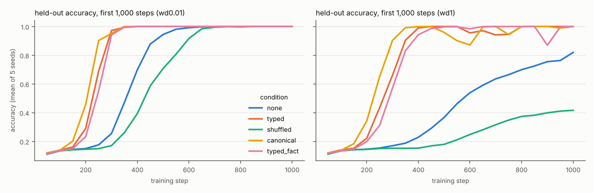
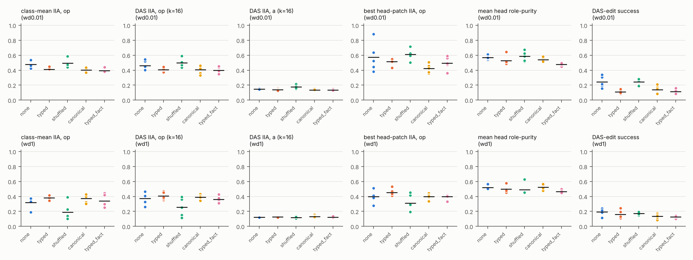

# 6. Prototype results: do typed priors make a network easier to locate, edit, and transfer?

*All numbers come from `results/` and are regenerated by the scripts. Raw data: `results/wd*/metrics.json`;
auto-generated tables: `results/wd*/summary.md`. Compute: about 2 CPU-hours total on 4 cores, no GPU.*

## 6.1 The smallest credible experiment

**Task.** Seven tokens: six content tokens and a query `=`. Exactly one operator (ADD / SUB / MUL)
sits at position 1–4. The **operands are the numbers immediately left and right of the operator**;
the other three numbers are distractors. Target: `OP(a, b) mod 11`. The same number token can be
LEFT, RIGHT or DISTRACTOR depending on context, so the roles are **contextual functional types** in
ANLU's sense. A unit test checks this.

**Network.** A 2-layer, attention-only, LayerNorm-free transformer (d = 64, 4 heads), then an MLP
(256 units) and the unembedding: 68,800 parameters, identical in every condition. There is no
LayerNorm, so a weight edit to `W_in` is an exact affine change at the site `h = resid_pre_mlp`
(tested exactly).

**Five matched conditions**, with the same parameter count, data stream, optimizer and steps:

| condition | input | what it isolates |
|---|---|---|
| `none` | `e = c + p` | baseline |
| `typed` | `e = c + t_τ + p`, true contextual roles | ANLU |
| `shuffled` | role ids permuted within each sequence (same marginals, no information) | does *meaningful* typing matter? |
| `canonical` | no types; sequence reordered to `[a, OP, b, d, d, d, =]` | **the same role information delivered by position instead of type geometry.** This is the information control. |
| `typed_fact` | typed, with content in dims 0–47 and type in dims 48–63 (hard orthogonal-subspace prior) | a strong form of ANLU's geometric prior |

**Two pre-declared regimes:** weight decay 0.01 (light) and 1.0 (strong, which the grokking
literature associates with structured circuits). Each condition has 5 seeds and 3,000 steps per
regime: 50 networks in total.

**Measurements.** None of them is given the type labels; they use only inputs, activations and
task variables.

| metric | question | type |
|---|---|---|
| steps to 95% | H1: learning efficiency | behavioral |
| linear probe accuracy | is the variable *present* at the site? | decodability (not causal) |
| class-mean IIA | does a training-free rank-r subspace causally carry the variable? | **causal** (interchange intervention) |
| DAS IIA, k ≤ 16 | does *any* learned rank-k subspace carry it? (Geiger et al. 2023) | **causal**, strongest linear test |
| head-patch IIA | does one head, or a pair, carry it? | **causal**, component level |
| head role purity | does each head's `=` attention go to one role? | human-legible routing |
| closed-form edit success / collateral | does a rank-one *weight program* re-route op X→Y? | **intervention** |
| DAS-guided edit | the same, moving activations only inside the DAS subspace | intervention tied to localization |
| CKA, Procrustes, rerun/copy/aligned ΔW | H5: reproducibility and transfer across seeds | **transfer** |
| reference NRI document, executed | 8 executable claims per model | the NRI loop end to end |

## 6.2 The instrument works (validity controls)

These are synthetic hosts with the trained head but a *constructed* site (`validity_check.py`,
`results/validity.json`):

| synthetic site | probe | class-mean IIA (op / a) | DAS op (k = 2) | DAS a (k = 16) | edit success / preserve |
|---|---|---|---|---|---|
| **disentangled** (op, a, b in disjoint blocks) | 1.00 | **0.99 / 1.00** | **1.00** | **1.00** | **0.995 / 0.995** |
| **entangled** (random code per triple) | 0.56–0.70 | 0.37 / 0.12 (chance) | 0.35 | 0.11 | 0.08 / 1.00 |

The causal metrics and the closed-form edit program succeed **when a variable is linearly localized**
and fail when it isn't. The low values in the trained networks therefore describe the networks, not
a broken instrument.

## 6.3 Main results

*Dots are seeds; bars are means. Full tables with SDs: `results/wd0.01/summary.md`, `results/wd1/summary.md`.*

### Regime wd = 0.01 (every model reaches 100% test accuracy)

| condition | steps→95% | probe a | class-mean IIA op | DAS op (k = 16) | DAS a (k = 16) | best head IIA op | head purity | DAS-edit success | CKA across seeds |
|---|---|---|---|---|---|---|---|---|---|
| none | 520 ± 45 | 0.94 | 0.48 | 0.46 | 0.15 | 0.57 | 0.57 | 0.24 | 0.44 |
| **typed** | **310 ± 22** | 1.00 | 0.41 | 0.41 | 0.14 | 0.51 | 0.53 | **0.11** | 0.37 |
| shuffled | 580 ± 67 | 0.95 | 0.49 | 0.50 | 0.18 | 0.61 | 0.59 | 0.24 | 0.51 |
| **canonical** | **270 ± 27** | 1.00 | 0.40 | 0.41 | 0.14 | 0.42 | 0.54 | **0.14** | 0.36 |
| typed_fact | 320 ± 27 | 1.00 | 0.39 | 0.40 | 0.14 | 0.50 | 0.48 | 0.11 | 0.32 |

Permutation tests against `none` (5 vs 5 seeds, two-sided, uncorrected):

- **steps→95%:** typed −210 (p = 0.008), canonical −250 (p = 0.008), typed_fact −200 (p = 0.008), shuffled +60 (p = 0.24).
- **DAS-edit success:** typed −0.13 (p = 0.008), typed_fact −0.13 (p = 0.017), canonical −0.10 (p = 0.058).

### Regime wd = 1.0 (strong weight decay)

| condition | final acc | steps→95% | class-mean IIA op | DAS op | best head IIA op | DAS-edit success | CKA |
|---|---|---|---|---|---|---|---|
| none | 0.90 ± 0.23 (1 seed at 0.49) | 1,063 ± 315 | 0.32 | 0.37 | 0.40 | 0.19 | 0.38 |
| **typed** | 1.00 | **380 ± 27** | 0.38 | 0.41 | 0.45 | 0.16 | 0.44 |
| shuffled | 0.60 ± 0.28 | (4/5 never) | 0.19 | 0.26 | 0.31 | 0.17 | 0.49 |
| **canonical** | 1.00 | **340 ± 22** | 0.37 | 0.39 | 0.40 | 0.14 | 0.39 |
| typed_fact | 1.00 | 420 ± 57 | 0.34 | 0.36 | 0.40 | 0.13 | 0.31 |

The small typed-vs-none gains here (class-mean IIA op +0.06, p = 0.08) are confounded: two `none`
seeds and three `shuffled` seeds have not fully learned the task, which lowers their causal metrics
for a trivial reason. The clean comparison is typed vs canonical, where both conditions converge,
and there the two are indistinguishable.

### Transfer of the closed-form op-swap edit across seeds (wd = 0.01)

| condition | rerun program | copy ΔW | Procrustes-aligned ΔW |
|---|---|---|---|
| none | 0.27 | 0.09 | 0.26 |
| typed | 0.17 | 0.09 | 0.15 |
| canonical | 0.18 | 0.09 | 0.15 |

As in WeightCode, a **copied delta does nothing** (0.09 is roughly the no-edit rate). Re-deriving
the edit, by rerunning the program or by aligning coordinates, recovers whatever the program
achieves on that host. **Typed priors did not make coordinates more reproducible:** CKA across
seeds is lower for typed than for none in the light regime and indistinguishable in the strong one.

### Executed reference NRI documents (8 claims per model, wd = 0.01)

| claim | none | typed | shuffled | canonical | typed_fact |
|---|---|---|---|---|---|
| behavior (≥ 0.99) | 5/5 | 5/5 | 5/5 | 5/5 | 5/5 |
| `linear_rep` op / a / b (IIA ≥ 0.9) | 0/5 each | 0/5 | 0/5 | 0/5 | 0/5 |
| necessity a (mean-ablation → ≤ 0.5) | **5/5** | 2/5 | **5/5** | 2/5 | 2/5 |
| edit ADD→SUB (≥ 0.9, preserve ≥ 0.97) | 0/5 | 0/5 | 0/5 | 0/5 | 0/5 |

When the model is given role information (typed, canonical), ablating the operand's subspace
**fails to break the model** in most seeds: operand information is stored more redundantly. This
points the opposite way from H2.

## 6.4 Findings, stated against the hypotheses

1. **H1 (efficiency): supported, but by the information, not the geometry.** Typed priors cut steps
   to 95% by 40% (light regime) and 64% (strong regime), and they are the difference between
   learning and not learning under strong weight decay. **The canonical control is equally fast or
   faster in both regimes**, and shuffled types give no benefit. The gain comes from *supplying
   role information*, and how it is supplied (an additive type vector vs a fixed position) does not
   matter. The factored orthogonal-subspace prior (typed_fact) adds nothing over plain typing.
2. **H2 / H3 (localization, interpretability): not supported in this toy.** In every condition the
   variables are 94–100% decodable (light regime) but **not causally separable** at the site that feeds the
   computation (DAS ≤ 0.50 for op, ≤ 0.18 for operands, against 1.00 on the disentangled control).
   No single head carries a variable, and head routing is soft (purity ≈ 0.5). Typed models are, if
   anything, slightly *less* localizable in the light regime, and canonical shows the same shift.
3. **H4 (editability): not supported.** Closed-form and DAS-guided rank-one edits succeed 11–32% of
   the time in every condition and regime, with typed ≤ none. Collateral is ≤ 4% in the light
   regime and 12–27% in the strong one.
4. **H5 (reproducibility / transfer): not supported.** Typed seeds are not more similar (CKA), and
   copied deltas fail everywhere.
5. **Mechanistic reason.** The blinded LLM interpreter found this first (§6.5), it is consistent
   with the DAS failure, and I re-measured it on all seeds. The attention layers already compute
   **op-specific interaction features**: the interpreter's Fourier analysis found a+b terms on ADD
   inputs and a−b terms on SUB inputs. Variance explained at the site by an additive one-hot
   (op + a + b) model, against a full (op, a, b) cell-mean model (16,384 inputs, 5 seeds, wd = 0.01):

   | condition | additive R² | cell-mean R² |
   |---|---|---|
   | none | 0.63 ± 0.07 | 0.97 |
   | typed | **0.53 ± 0.05** | 0.99 |
   | canonical | **0.55 ± 0.07** | 1.00 |

   The computation is spread across attention and MLP, so no "variable register" exists for a weight
   program to target. **Supplying role information makes the site *less* additive.** The network
   starts mixing operands earlier, which explains why typed and canonical models are slightly less
   localizable and editable.

## 6.5 Blinded LLM-interpreter pilot (Experiment A, n = 2)

**Setup.** Two separate LLM agents (same model family as the orchestrator; general-purpose agent
with shell and Python) each received **one network**:

- `net_K7` = `none_s0`; `net_Q2` = `typed_s0`, both wd = 0.01.
- Each package held only weights, architecture code, 20,000 unlabeled valid inputs, the NRI schema,
  and a goal stated in behavioral terms: "wherever token 11 occurs, output what you would if it were
  token 12".
- No task description, no type names, no training code.
- **Blinding audit:** a transcript scan found 0 tool calls touching any path outside the package in
  either run (34 and 33 tool calls), and no relative-path escapes.

**Scored by the NRI executor** (`results/pilot/*/score.json`):

| | net_K7 (untyped) | net_Q2 (typed) |
|---|---|---|
| exact task rule recovered (agrees on 20,000/20,000 inputs) | yes | yes; also **decoded the unlabeled type channel's meaning** (1 = a, 2 = b, 3 = op, 4 = query) |
| variable recall: op / a / b | 1.0 / 1.0 / 1.0 | 1.0 / 1.0 / 1.0 |
| claims verified | 3/4 | 3/6 |
| `linear_rep` claims | op **refuted** (IIA 0.46) | op / a / b **refuted** (0.41 / 0.11 / 0.12) |
| edit vs true goal: success / preserve | 0.36 / 0.97 | **0.94 / 0.98** |
| edit rank, ‖ΔW‖ / ‖W_in‖ | **64 (full), 7.5×** | **64 (full), 5.2×** |

**Cross-evaluation**: each agent-written program rerun on hosts it never saw (`pilot/cross_eval.py`,
`results/pilot/cross_eval.json`). Success on the true goal:

| program ↓ / host → | none s0 | none s1 | none s2 | typed s0 | typed s1 | typed s2 |
|---|---|---|---|---|---|---|
| K7's (written on none_s0) | *0.36* | 0.46 | 0.63 | 0.62 | 0.35 | 0.40 |
| Q2's (written on typed_s0) | 0.60 | 0.59 | 0.78 | *0.94* | 0.72 | 0.85 |

*Italics: the host the program was written on. Preservation is 0.86–1.00 throughout.*

**What the pilot shows**, with heavy caveats (n = 2, one interpreter family):

- **Behavioral interpretation was easy for both**, regardless of prior: the exact rule and all
  ground-truth variables were found.
- **Both interpreters treated "linearly decodable" as "causally represented"**, and the executor
  refuted every such claim. *Harness caveat:* the original instructions did not say that
  `linear_rep` is tested by interchange. That has since been fixed in the schema and package text,
  for future runs. This is still the field's central failure mode (decodability ≠ mechanism), and
  the NRI caught it automatically.
- **Both "edits" are regression fits, not targeted programs.** They are full-rank rewrites of `W_in`
  with norms 5–7× the original weights. That is *optimization in closed form*, not a localized
  intervention. The NRI's rank and norm fields make this visible, which is exactly the
  interpretation-vs-optimization distinction the brief asks for. In this sense, the agents'
  "understanding" was used to *specify targets*, not to locate a mechanism.
- **The pilot's typed advantage (0.94 vs 0.36) is mostly the interpreter, not the network:** Q2's
  program beats K7's on **all six** hosts, including untyped ones, while K7's program does no better
  on typed hosts. Q2's program also does best on its own host (0.94 vs 0.72–0.85 on other typed
  seeds): an own-host fit.
- **Programs transfer partially** (0.35–0.85 on unseen hosts) because they re-derive their targets
  from each host, consistent with WeightCode.

## 6.6 Limitations

- **A toy.** It has 3 operations, 11 numbers, a 68.8K-parameter model, and an attention-only
  routing stage, and the task is easy enough to be memorized in a few hundred steps. Types here are
  computed perfectly by an oracle, while ANLU's would come from an imperfect typer.
- **One site family** (`resid_pre_mlp`, plus head outputs). Variables could be localized elsewhere
  (e.g. at operand positions after layer 1). The NRI would let an interpreter claim that, but our
  automated metrics did not search it.
- **5 seeds per arm.** The p-values are uncorrected and exploratory. The efficiency result
  (p = 0.008, the minimum attainable with 5 vs 5) and the typed ≈ canonical equivalence are the
  robust findings.
- **Interpreter pilot:** n = 2, one LLM family, honor-system blinding (audited post hoc), and an
  instruction ambiguity about `linear_rep` (now fixed).

## 6.7 Bottom line for the central question

On this toy, **ANLU-style typed embeddings make networks learn faster, but they do not make
networks more understandable or programmable**, by any causal measure, and the learning-speed gain
is fully explained by the information the types carry rather than by type geometry. A hard
orthogonal-subspace prior on the *input* does not propagate to a disentangled *internal*
representation, because the network's first operation mixes the subspaces. If disentangled
internals are the goal, they must be **maintained by the loss** (roadmap R6: an IIT-style
`L_struct` and an internal edit-ready objective), not just seeded at the embedding layer.

## 6.8 What to run next

See doc 04. In order:

1. **R1 at scale:** ≥ 10 networks per arm, white-box vs **black-box** interpreters, using the
   corrected `linear_rep` instructions.
2. **R6:** an IIT-style `L_struct` that forces each variable into a fixed subspace. *Check whether it
   produces typed-or-not localizable variables and higher edit success on held-out edit types.*
   This is the test of whether "programmable by design" is achievable at all.
3. **R2:** unit-bearing arithmetic with a learned, noisy typer, so the types carry information that
   is *not* trivially positional.
