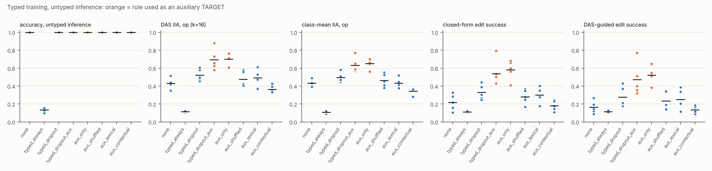

# 8. ANLU as specified: typed training, untyped inference

*Experiment B1. Script: `run_untyped_inference.py`. Data: `results/untyped_inf/metrics.json`;
auto-generated table: `results/untyped_inf/summary.md`; figure: `results/fig_untyped_inference.png`.
40 networks; about 1 CPU-hour.*

## 8.1 Why this experiment

The ANLU Foundation Specification and the Pedagogy paper (v3.0) make **typed training, untyped
inference** the core differentiator. Types are scaffolding removed at inference, internalized
"through an auxiliary type prediction objective". The first prototype (doc 06) supplied types *at
inference too*. It therefore tested the runtime-dependency variant that the Pedagogy paper itself
predicts to be a crutch. This experiment tests the specification as written.

## 8.2 Design

- **Task, architecture and optimizer:** the same as doc 06 (light regime, wd = 0.01), with 5 seeds
  and 3,000 steps.
- **Matched parameters:** every condition has a 6-row type table (0 = NONE, role + 1 otherwise) and a
  5-way auxiliary head on the layer-1 residual. Total: 69,189 parameters everywhere.
- **The auxiliary head is training-only.** It attaches at a low layer, following Søgaard & Goldberg
  (2016).
- **Untyped evaluation:** every number below uses inputs with all type ids = NONE.

| condition | type input during training | auxiliary target (λ = 1) |
|---|---|---|
| `none` | never | none |
| `typed_always` | every sequence | none |
| `typed_dropout` | 50% of sequences | none |
| `typed_dropout_aux` | 50% of sequences | contextual role |
| `aux_only` | never | contextual role |
| `aux_shuffled` (control) | never | roles shuffled within sequence (unlearnable) |
| `aux_lexical` (control) | never | `token mod 5` (learnable, task-irrelevant, no context needed) |
| `aux_contextual` (control) | never | left neighbor's `token mod 5` (learnable, task-irrelevant, needs the same neighbor lookup as roles) |

## 8.3 Results (mean ± sd over 5 seeds, untyped inference)

| condition | accuracy | steps→95% | DAS IIA op | class-mean IIA op | closed-form edit | DAS-guided edit | additive R² |
|---|---|---|---|---|---|---|---|
| none | 1.00 | 500 ± 61 | 0.43 ± 0.06 | 0.43 ± 0.04 | 0.22 ± 0.09 | 0.16 ± 0.07 | 0.63 |
| typed_always | **0.14 ± 0.02** | never | 0.12 | 0.11 | 0.11 | 0.11 | 0.29 |
| typed_dropout | 1.00 | 500 ± 61 | 0.52 ± 0.06 | 0.50 ± 0.05 | 0.33 ± 0.09 | 0.28 ± 0.11 | 0.65 |
| **typed_dropout_aux** | 1.00 | 510 ± 22 | **0.69 ± 0.12** | **0.63 ± 0.08** | **0.54 ± 0.15** | **0.47 ± 0.18** | 0.70 |
| **aux_only** | 1.00 | 540 ± 22 | **0.70 ± 0.06** | **0.65 ± 0.06** | **0.58 ± 0.11** | **0.52 ± 0.10** | 0.69 |
| aux_shuffled | 1.00 | 580 ± 45 | 0.48 ± 0.08 | 0.46 ± 0.08 | 0.28 ± 0.08 | 0.23 ± 0.10 | 0.63 |
| aux_lexical | 1.00 | 610 ± 129 | 0.49 ± 0.09 | 0.43 ± 0.05 | 0.30 ± 0.09 | 0.25 ± 0.11 | 0.67 |
| aux_contextual | 1.00 | 510 ± 65 | 0.37 ± 0.04 | 0.34 ± 0.04 | 0.18 ± 0.06 | 0.14 ± 0.04 | 0.68 |

**Permutation tests** (5 vs 5 seeds, two-sided; 0.008 is the smallest attainable p):

| comparison | DAS op | closed-form edit | DAS-guided edit |
|---|---|---|---|
| aux_only vs none | +0.27, p = 0.008 | +0.36, p = 0.008 | +0.36, p = 0.008 |
| aux_only vs aux_lexical | +0.21, p = 0.016 | +0.28, p = 0.008 | +0.27, p = 0.016 |
| aux_only vs aux_contextual | +0.34, p = 0.008 | +0.40, p = 0.008 | +0.39, p = 0.008 |
| aux_only vs aux_shuffled | +0.22, p = 0.008 | +0.30, p = 0.008 | +0.29, p = 0.008 |
| aux_only vs typed_dropout | +0.18, p = 0.008 | +0.25, p = 0.016 | +0.24, p = 0.016 |
| typed_dropout_aux vs typed_dropout | +0.17, p = 0.024 | +0.21, p = 0.023 | +0.19, p = 0.074 |
| typed_dropout vs none | +0.09, p = 0.055 | +0.11, p = 0.087 | +0.11, p = 0.10 |

These p-values are **uncorrected**. With 5 vs 5 seeds the smallest attainable two-sided p is
0.008, which cannot survive a Holm correction across this 18-test family (first threshold
0.05/18 ≈ 0.003). The evidence is therefore:

- consistency: every role-supervised arm beats every control on every causal metric, in every
  comparison;
- large effect sizes: the seed distributions barely overlap (see the figure).

A confirmatory replication needs ≥ 10 seeds per arm, with the primary comparison (aux_only vs
aux_contextual, DAS-guided edit success) pre-registered.

## 8.4 Findings

1. **The scaffold cannot simply be removed.** A model trained with types on every sequence drops to
   chance-level accuracy (0.14) without them, while scoring 1.00 with them. It never learned to
   compute roles: its layer-1 role probe falls to 0.53, against 1.00 for `none`. The Foundation
   spec's claim that types are "not required at inference" therefore needs a **mechanism**. Type
   dropout is sufficient for accuracy (1.00).
2. **No learning-speed benefit under untyped inference.** Every arm that works without types
   reaches 95% in 500–610 steps, against 500 for `none`. The 40–64% speed-up in doc 06 existed only
   while types were supplied at inference. That makes it the *information* effect the `canonical`
   control identified. **ANLU's efficiency claim (H1) is not supported in its specified form, in
   this toy.**
3. **Types as training *targets* make the internals substantially more localizable and editable.**
   This is the first positive result for the program.
   - An auxiliary role-prediction loss raises DAS localization of the operator from 0.43 to 0.70.
   - It roughly triples closed-form edit success (0.22 → 0.58) and DAS-guided edit success
     (0.16 → 0.52), all at p = 0.008.
   - **It is specific to meaningful role targets.** Unlearnable shuffled roles, a learnable lexical
     target, and a learnable contextual target that needs the *same neighbor lookup* as roles all
     give no improvement (the contextual one is slightly worse).
   - Role *information* is present in every working model (layer-1 probe ≥ 0.90), so the
     auxiliary loss changes how the computation is **organized**, not what it knows.
   - Using types as an **input** scaffold with dropout gives only a small, non-significant gain
     (p ≈ 0.06–0.10). Using them as a **target** gives the large one.
4. **The effect is partial.** Operand localization stays low in every condition (DAS a ≤ 0.28), and
   the best edit success is about 0.6, not 1.0. Role supervision cleans up *routing*, but the
   operand–operand mixing found in doc 06 §6.4 remains. Supervising the operand variables at the
   MLP input would be the next step (an IIT-style `L_struct`; roadmap R6).

## 8.5 What this means for the ANLU program

| ANLU claim (as specified) | Verdict here (toy scale) |
|---|---|
| Types are not a runtime dependency | **Only with a mechanism.** Without dropout or an auxiliary loss, removal breaks the model. |
| Faster convergence | **Not supported** under untyped inference. The only speed gain comes from supplying types at inference. |
| Types pre-structure geometry through the *input* embedding | **Weak.** Typed-input dropout gives a small, non-significant gain in localization and editability. |
| Types internalized via an auxiliary type-prediction objective (Pedagogy v3.0) | **Supported, and the effect is specific to meaningful roles**: +0.27 DAS IIA, ~2.7× edit success vs `none`; no effect from matched controls. |

**Revised ANLU claim that these data support.** Functional types used as a *training-time
auxiliary target* (a scaffold in the Swayamdipta et al. 2018 sense) make the network's internal
computation more causally localizable and more programmable by closed-form weight edits, with no
inference-time cost and no loss of accuracy. That is an **interpretability and editability** claim,
not an efficiency claim. It connects ANLU directly to the "train for editability" question in the
original brief (Experiment E).

**What would make it a publishable contribution:**
1. Replicate at ≥ 10 seeds.
2. Show it on a task where the types are *not* recoverable from position:
   - unit-bearing arithmetic (R2), and
   - a small LM with teacher-labeled types.
3. Test whether the gain holds for *held-out* edit types and for the blinded LLM interpreters (R1).
4. Compare against weight-sparse training (Gao et al. 2025) and ERT, which buy interpretability
   by different routes.
