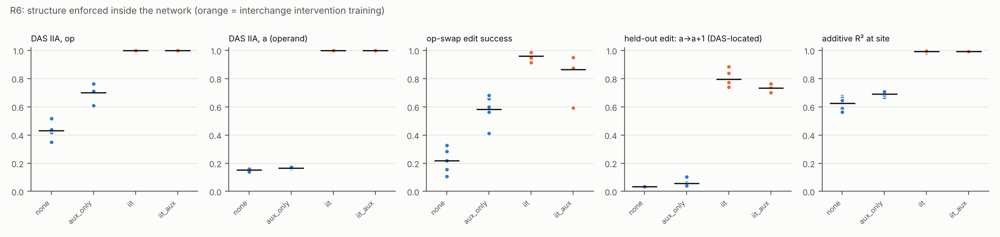

# 9. R6: enforcing structure inside the network (interchange intervention training)

> **Update after the pre-registered replication on dimensional reasoning (doc 12).** On a harder
> task, IIT still improves held-out edits significantly, but much less: 0.36 vs 0.17, not 0.80 vs
> 0.04. It does not improve generalization to held-out unit combinations. It is
> optimization-unstable: 5/10 full-spec seeds fall into a sign-ambiguity trap.
>
> **Retracted:** the claim of "no significant slowdown" in §9.4, which was measured in steps, on
> one easy task. The findings below hold for the modular-arithmetic task only.
>
> **Variable-specificity check (doc 12 §12.8):** for ADD, the operand-shift edit's output cannot
> distinguish a+1 from b+1. On the discriminating rows (SUB; MUL with a ≠ b), IIT networks hit the
> intended target 0.797 of the time and the wrong-variable target 0.023 (specificity +0.77;
> baselines 0.00). The R6 editability result is variable-specific.

*Script: `run_iit.py`. Data: `results/iit/metrics.json`; table: `results/iit/summary.md`;
figure: `results/fig_iit.png`. 10 new networks, plus 10 reused from doc 08 with an identical setup.
About 1 CPU-hour.*

## 9.1 Question

Doc 06 showed that structure injected at the *input* does not survive the first mixing layer. Doc 08
showed that supervising the network to *compute* roles helps (operator localization 0.43 → 0.70),
but leaves the operands entangled. This experiment enforces the structure directly at the site
where the computation reads it, then asks the question from the original brief: **are the resulting
circuits easier to locate and to edit, and does that hold for edits the training never saw?**

## 9.2 Method

**Interchange intervention training** (IIT; Geiger et al., *Inducing Causal Structure for
Interpretable Neural Networks*, ICML 2022).

- At `h = resid_pre_mlp`, fixed coordinate blocks are assigned to the three variables: op → dims
  0–7, a → 8–23, b → 24–39. The remaining 24 dims are free.
- At every step, for each variable: copy its block from an independent source input into the base
  activation, and train the output to equal the counterfactual `OP(a, b)` with that variable taken
  from the source. The loss is task + 1.0 × IIT.

**Conditions** (5 seeds each; untyped inference; identical architecture, 69,189 parameters):

| condition | objective |
|---|---|
| `none` | task |
| `aux_only` | task + auxiliary role loss (doc 08's best arm) |
| `iit` | task + IIT |
| `iit_aux` | task + IIT + auxiliary role loss |

**Measurement is blind to the design.** Class-mean subspaces, DAS and the closed-form edit programs
do not know where the blocks are. The only exceptions are the explicitly labelled "designed-block"
columns.

**Held-out edit family: operand shift.** Make the network compute `OP(a+1, b)`. This is an affine
edit inside the subspace located for `a`, fitted by least squares on activations and folded into
`W_in`. IIT trains *interchanges* of `a`, never *shifts*, so this is a different kind of edit.

**Instrument check** (synthetic hosts from `validity_check.py`): on the disentangled host the
operand-shift edit succeeds 0.977 of the time; on the entangled host 0.03, equal to the no-op rate.
The tool works when the structure exists.

## 9.3 Results (mean ± sd over 5 seeds; untyped inference)

| | none | aux_only | **iit** | iit_aux |
|---|---|---|---|---|
| task accuracy | 1.00 | 1.00 | **1.00** | 1.00 |
| steps → 95% | 500 ± 61 | 540 ± 22 | 560 ± 74 | 630 ± 144 |
| DAS IIA op / a / b (k = 16, blind) | 0.43 / 0.15 / 0.16 | 0.70 / 0.17 / 0.17 | **1.00 / 1.00 / 1.00** | 1.00 / 1.00 / 1.00 |
| class-mean IIA op / a (training-free, blind) | 0.43 / 0.12 | 0.65 / 0.12 | **1.00 / 0.80** | 1.00 / 0.64 |
| designed-block IIA op / a / b | 0.36 / 0.13 / 0.14 | 0.36 / 0.14 / 0.14 | **1.00 / 1.00 / 1.00** | 1.00 / 1.00 / 1.00 |
| op-swap edit success (class-mean, blind) | 0.22 | 0.58 | **0.96 ± 0.03** | 0.87 ± 0.16 |
| **held-out a→a+1 edit** (DAS-located, blind; no-op = 0.03) | 0.04 | 0.06 | **0.80 ± 0.06** | 0.73 ± 0.03 |
| held-out a→a+1 edit (class-mean-located, blind) | 0.07 | 0.10 | 0.73 ± 0.07 | 0.67 ± 0.10 |
| held-out a→a+1 edit (designed block) | 0.03 | 0.03 | 0.81 ± 0.08 | 0.77 ± 0.05 |
| additive R² at the site | 0.63 | 0.69 | **0.99** | 0.99 |

**Permutation tests**, `iit` vs `none` and vs `aux_only` (5 vs 5 seeds; p = 0.008 is the smallest
attainable):

- DAS op: +0.57 and +0.30
- DAS a: +0.85 and +0.83
- op-swap edit: +0.74 and +0.38
- held-out a+1 edit: +0.76 and +0.74

All of these are at p = 0.008. The seed distributions do not overlap. Learning speed is not
significantly different (+60 steps, p = 0.29).

## 9.4 Findings

1. **Enforcing variable structure at the computation site works, with no accuracy cost and no
   significant slowdown.** Every variable becomes perfectly causally localizable (DAS = 1.00 for op,
   a and b, against 0.15–0.43 at baseline). The site becomes almost exactly additive (R² 0.99).
2. **Standard interpretability tools find the designed structure without being told where it is.**
   Blind DAS reaches 1.00 everywhere. Training-free class-mean subspaces reach 1.00 for op and 0.80
   for a. Training for interpretability makes the network legible to *generic* tools, not just to
   its designer.
3. **The networks become programmable by closed-form weight edits, including a held-out edit type.**
   - The operator-reroute edit succeeds 96% of the time, against 22%.
   - The operand-shift edit, a kind of edit the training never saw, succeeds 73–81% of the time,
     against 3–7%: a 10–25× improvement.
   - The edit works almost equally well whether the subspace is found blind (DAS, 0.80) or read
     from the design (0.81). Localization is no longer the bottleneck.
4. **Adding the role auxiliary loss on top of IIT does not help** (iit_aux ≤ iit everywhere, n.s.).
   Once the computation site is structured, the input-side role scaffold is redundant.
5. **Why the edits are not 100%.** The shift edit is *affine*, but "a ↦ a+1 mod 11" is a cyclic
   permutation of 11 class means, and a cyclic permutation is not exactly affine on an arbitrary
   embedding of those means. The ceiling is set by how the network embeds `a` inside its block,
   not by entanglement with other variables. An edit program that knows the embedding is
   cyclic would do better. That is an NRI-level fact worth recording: "a is stored as a cyclic
   code in block B" (see §9.6).

## 9.5 What this means for the program

- **For ANLU** (docs 02, 07): the strongest version of the structural-prior thesis that these data
  support is not "type vectors at the input" but **"declared variables enforced at the site where
  they are used"**. Your type schema supplies *which* variables to declare (NUMBER/LEFT,
  NUMBER/RIGHT, OPERATION, UNIT, …); IIT supplies the mechanism. Typed training still costs nothing
  at inference: the blocks are an internal property of the weights.
- **For the NRI** (doc 03): an IIT-trained network ships with a *machine-checkable, true* NRI by
  construction. Its `linear_rep` claims for the designed blocks verify at 1.00. Edit programs can
  be written against the declared interface instead of reverse-engineered. That is what
  "programmable by design" would mean operationally.
- **For the field:** this is a small-scale demonstration of training-time interpretability for
  *editability*, which is what ERT (2611.26408) does for heads and weight-sparse training (Gao et
  al. 2025) does for circuit size. Unlike ERT, the edit tested here is a **held-out internal edit
  type**.

## 9.6 Limitations and next steps

- **Scale:** the IIT target here is a perfectly known causal model of a toy task. Real language
  data has no such ground-truth graph. The realistic analogue declares *some* variables (ANLU types,
  NUMBER/UNIT/QUANTITY values) and leaves the rest free, which is exactly what the 24 free dims do
  here. Testing on partially specified causal models is the next step (R2 + R6).
- **Is it the causal objective, or extra compute or regularization?** IIT doubles the forward
  passes per step. A compute-matched control is needed: interchange the blocks but train the
  output to be *invariant* (base label). That uses the same compute with no causal alignment.
- **Edit expressiveness:** add a cyclic-shift edit program (the permutation acting within the
  block) to separate "variable is localized" from "the affine edit family is too weak".
- **Seeds:** 5 per arm. Primary metrics should be pre-registered at ≥ 10 seeds before any
  confirmatory claim.
