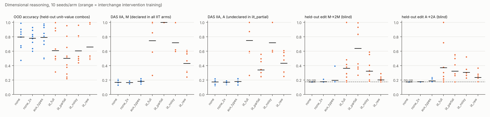

# 12. Results of the pre-registered dimensional-reasoning study

*Registration: doc 11, commit `b464be4`, made before the main run. Script: `run_dimensional.py`.
Data: `results/dim/metrics.json`; auto-generated tables and tests: `results/dim/summary.md`,
`results/dim/tests.json`; figure: `results/fig_dimensional.png`. 70 networks (7 arms × 10 seeds),
about 3 CPU-hours.*

## 12.1 Headline

1. **P1 (programmability with a full specification): supported, but small.** Held-out M→2M edit
   success is 0.36 for `iit_full` vs 0.17 for `none`: Δ = +0.19, p = 0.0004, rejected after Holm
   correction. That is far smaller than R6's 0.80 vs 0.04 on modular arithmetic.
2. **P2 (generalization to held-out unit combinations): not supported.** OOD accuracy is 0.61
   for `iit_full` vs 0.80 for `none`: Δ = −0.19, p = 0.059, not rejected. The direction is
   **opposite** to the prediction.
3. **The decisive unplanned finding: interchange training is optimization-unstable on this task.**
   Seeds reaching 95% in-distribution accuracy: `iit_full` 5/10, `iit_noisy` 3/10, `iit_raw`
   3/10. Without IIT: `none` 9/10, `none_2x` 10/10, `aux_types` 8/10. **Every failed seed in every
   arm (22/22) makes only sign-flip errors.** It outputs −F instead of F, i.e. it learned the
   product only up to sign (§12.4). The single pilot seed used to pick the budget happened to
   converge, so the pilot did not reveal this.

## 12.2 Pre-registered results (all 10 seeds per arm; nothing excluded)

| arm | converged (ID ≥ 0.95) | acc ID | acc OOD | DAS M | DAS A | M→2M edit (blind) | A→2A edit (blind) | additive R² |
|---|---|---|---|---|---|---|---|---|
| none | 9/10 | 0.97 | **0.80** | 0.17 | 0.18 | 0.17 | 0.17 | 0.31 |
| none_2x (compute-matched) | 10/10 | 1.00 | 0.78 | 0.17 | 0.17 | 0.18 | 0.18 | 0.32 |
| aux_types (ANLU roles) | 8/10 | 0.94 | 0.79 | 0.18 | 0.18 | 0.20 | 0.19 | 0.38 |
| iit_full | **5/10** | 0.83 | 0.61 | 0.75 | 0.75 | **0.36** | 0.37 | 0.51 |
| **iit_partial** (M only) | **10/10** | 1.00 | 0.50 | **1.00** | 0.34 | **0.64** | 0.32 | 0.64 |
| iit_noisy (25% bad targets) | **3/10** | 0.75 | 0.60 | 0.72 | 0.72 | 0.32 | 0.31 | 0.52 |
| iit_raw (non-invariant vars) | **3/10** | 0.73 | 0.66 | 0.43 | 0.43 | 0.20 | 0.24 | 0.31 |

The edit no-op rate is 0.17: products with a zero factor are unchanged by doubling.

**Primary family** (two-sided permutation tests, 200,000 permutations, Holm at α = 0.05):

| hypothesis | comparison | Δ | p | verdict |
|---|---|---|---|---|
| **P1** | M→2M edit, iit_full − none | +0.189 | 0.00044 | **supported** |
| **P2** | OOD accuracy, iit_full − none | −0.187 | 0.059 | **not supported** (wrong direction) |

**Secondary predictions** (uncorrected, as registered):

| | prediction | result | verdict |
|---|---|---|---|
| S1 | iit_partial > none on M→2M (declared variable) | +0.465, p = 1e-5 | **supported**, and the largest effect in the study |
| S1 (open) | ...and on A→2A (undeclared variable)? | +0.150, p = 0.003 | some spill-over to the undeclared variable |
| S2 | iit_noisy > none on M→2M, retaining ≥ 50% of the full-spec gain | +0.150, p = 2e-5; retains 0.150 / 0.189 = **79%**; noisy vs full n.s. (p = 0.72) | **supported** |
| S3 | iit_raw ≤ iit_full on OOD | +0.050, p = 0.64 | **not supported** (no difference; direction opposite) |
| S3 (edit) | (raw should be less editable) | −0.159, p = 0.016 | consistent: non-invariant variables give worse edits |
| S4 | aux_types > none on DAS M | +0.013, p = 0.32 | **not supported** |
| S5 | iit_full vs none_2x on samples to 95% (converged seeds only) | +0.50M, p = 0.46 | inconclusive. **But half of the IIT seeds never converge, so IIT is clearly costlier to train. R6's "no significant slowdown" is retracted.** |
| S6 | none_2x = none on M→2M | +0.003, p = 0.84 | **supported**: extra compute or data does not produce editability |

## 12.3 Deviations from the registration (disclosed)

1. **Interrupted run, resumed.** The main run hit the session's 2-hour background-process limit
   after 64/70 networks. It was resumed with the identical command. The runner skips finished
   checkpoints; the six unfinished `iit_raw` seeds (4–9) were retrained from scratch, and training
   is deterministic. No result was inspected before the resume.
2. **Post-hoc analyses (§12.4, §12.5) were not registered.** The converged-seeds-only table and the
   sign-flip diagnosis were added after seeing the convergence failures. They explain the
   registered results but are **exploratory**.

## 12.4 Why IIT seeds fail: a sign-ambiguity trap (post hoc)

Failed networks sit on a plateau at about 0.60 accuracy from about step 2,000 to 6,000. They are
always correct when a factor is zero and correct on about half of nonzero products, for every M,
input order and force unit.

**All 22 failed seeds in all arms make only sign-flip errors.** Every wrong output equals −F mod
13 (fractions 0.998–1.000). These networks computed F up to sign. The multiplicative group mod 13
contains −1, and a representation that cannot distinguish x from −x is a stable local optimum.

The trap is a property of the task, not of IIT: it also catches 1/10 `none` and 2/10 `aux_types`
seeds. IIT makes it **2.5–7× more likely** (5–7/10 vs 1–2/10), plausibly because forcing the computation through fixed
low-dimensional blocks early in training locks in whichever coarse code appears first.

**Implications for method design:**
- A practical IIT recipe needs an optimization safeguard: warm-up of λ_IIT, restarts selected on
  a validation split, or an auxiliary loss that breaks the sign symmetry.
- A single converged pilot seed is not enough to choose a budget. The registration's budget rule
  should have required k of n pilot seeds.

## 12.5 Converged seeds only (post hoc, exploratory)

| arm | n converged | M→2M edit | A→2A edit | OOD | DAS M | designed-block IIA M |
|---|---|---|---|---|---|---|
| none | 9 | 0.17 | 0.17 | **0.83** | 0.16 | 0.15 |
| none_2x | 10 | 0.18 | 0.18 | 0.78 | 0.17 | 0.15 |
| aux_types | 8 | 0.20 | 0.19 | 0.87 | 0.18 | 0.16 |
| iit_full | 5 | **0.43** | **0.41** | 0.75 | 0.85 | 0.85 |
| iit_partial | 10 | **0.64** | 0.32 | 0.50 | 1.00 | 1.00 |
| iit_noisy | 3 | 0.31 | 0.38 | 0.74 | 1.00 | 1.00 |
| iit_raw | 3 | 0.18 | 0.24 | 0.99 | 0.39 | 0.38 |

Even when IIT converges:
- held-out edits reach only about 0.4–0.6, against 0.80 in R6;
- **generalization to held-out unit–value combinations is not improved, and is worse** for
  `iit_partial` (0.50 vs 0.83).

Declaring canonical (unit-invariant) variables at the MLP input does not by itself make the
*upstream* computation of those variables (value × unit scale, done in attention) generalize to
unseen value–unit pairs. The structure was enforced where the variables are *read*, not where
they are *computed*.

## 12.6 What this changes

| Earlier claim (docs 09–10) | Status after this study |
|---|---|
| IIT makes networks highly programmable (0.96 / 0.80 edits) | **Task-dependent.** On dimensional reasoning, edits improve significantly (P1), but to 0.36 (all seeds) or 0.43 (converged), not 0.8–0.96. |
| No accuracy cost, no significant slowdown | **Retracted.** Half of the full-spec IIT seeds fail to learn the task (sign trap). |
| Enforced structure → better generalization (implicit hope) | **Not supported.** No OOD benefit; the partial spec hurts OOD. |
| Partial specifications might not work | **They work best here.** Declaring only M gives perfect localization of M, the largest edit gain (+0.46), and 10/10 convergence. |
| Noisy specifications might break the method | **Robust to label noise in editability** (79% of the gain retained), but convergence suffers (3/10). |
| Extra compute explains the gains | **No.** The compute-matched baseline equals the baseline (S6). |
| ANLU role supervision helps | **Not on this task** (S4 n.s.). |

**Net:** the review's central question was whether the benefits survive *incomplete, noisy or
partially wrong* structural specifications.

- **For editability:** largely yes. Partial specifications give the best edits, and noisy ones
  keep most of the gain.
- **For trainability:** no, not without safeguards.
- **For generalization:** this study gives no evidence that enforced structure helps.

The narrower claim that survives: *declaring a variable and enforcing it at the site where it is
read makes that variable editable.* That holds even when it is the only variable declared, and
even with noisy supervision. It does not make the network generalize better, and it can make it
harder to train.

## 12.7 Next steps

1. **Fix the optimization, then re-test P1/P2 as a new registration:** λ warm-up (0 → 3 over the
   first third), plus best-of-k restarts selected on a validation split. Require ≥ 8/10 pilot
   seeds to converge before registering.
2. **Enforce structure where variables are *computed*, not only where they are read:** interchange
   at the value–unit binding (positions after layer 1) to target OOD unit generalization.
3. **Break the sign symmetry:** for example, an auxiliary target on the sign of F (its quadratic
   character), to test whether the trap is the only obstacle.
4. R1 at scale with a weights-only arm, still deferred (doc 10 §10.6).

## 12.8 Addendum (post hoc): does the edit change the *intended* variable?

*Prompted by a reviewer. The analysis is `edit_specificity.py`; the data are
`results/edit_specificity.{json,md}`. Everything in this section is exploratory: the edits below
were not registered, and the inversion edit was chosen after the additive edit failed.*

**The flaw in the registered edit (§11.4).** With F = M·A·S, the M→2M edit and the A→2A edit
both produce exactly 2F. An edit that simply doubled the *output* would score the same. **The
registered P1 result therefore shows that something changed, not that M changed.** The
localization measures (DAS, designed-block IIA) were the only evidence specific to M.

**Variable-discriminating edits.** These are scored only on examples where the intended target,
the wrong-variable target and the original answer are pairwise distinct. Each edited output is
classified as *intended*, *wrong-variable*, *unchanged* or *other*, and
specificity = P(intended) − P(wrong). On the synthetic disentangled host, specificity is 1.00; on
the entangled host it is 0.00.

| edit | what distinguishes it at the output | result |
|---|---|---|
| **M→M+1 / A→A+1** (proposed by the reviewer) | changes F by A·S vs M·S | **fails in every arm, for every localization, including designed blocks** (intended ≤ 0.105; chance 0.077) |
| **M→M⁻¹ / A→A⁻¹** (post hoc) | M⁻¹·A·S vs M·A⁻¹·S, distinct whenever A ≠ ±M | see below |

**Inversion edit, DAS-located (blind), 10 seeds per arm:**

| arm | M⁻¹ intended / wrong | **M⁻¹ specificity** (vs none) | A⁻¹ specificity (vs none) |
|---|---|---|---|
| none | 0.006 / 0.010 | −0.003 | +0.004 |
| none_2x | 0.000 / 0.000 | +0.000 | +0.000 |
| aux_types | 0.015 / 0.015 | −0.000 | −0.000 |
| iit_full | 0.139 / 0.038 | +0.101 (p = 0.054) | +0.136 (p = 0.18) |
| **iit_partial** (only M declared) | **0.357 / 0.022** | **+0.335 (p = 0.00007)** | **+0.019 (p = 0.87)** |
| iit_noisy | 0.119 / 0.059 | +0.060 (p = 0.048) | +0.028 (p = 0.011) |
| iit_raw | 0.056 / 0.050 | +0.007 | +0.006 |

Within `iit_partial`, the declared variable is more editable than the undeclared one in 9/10
seeds (paired exact sign-flip test, p = 0.006). Among converged `iit_full` seeds, M⁻¹ specificity
is +0.18 and A⁻¹ +0.21.

**Interpretation.**

1. **With a variable-discriminating test, the dimensional evidence is weaker than P1 suggested,
   but it is genuine where it exists.** Declaring a variable via IIT makes *that* variable, and
   not its sibling, specifically editable. The clearest case is the partial specification. That
   dissociation is the strongest evidence in this study for the original idea. It is post hoc and
   must be confirmed under registration.
2. **Why the additive edit fails everywhere.** IIT makes a block causally *sufficient* for a
   variable (copying a real activation works; designed-block IIA ≈ 1), but it does not make the
   block's geometry *clean*. In `iit_full_s0`'s M block, only 21% of the variance separates M
   values, and 62% of the within-class variance encodes which (value, unit) route produced M. A
   class-mean affine edit moves only the small M component and leaves the network off its data
   manifold. `iit_partial_s0`'s M block is much cleaner (91% between-class), matching its better
   edits. Some permutations of M (inversion) are reachable by an affine move in such a code and
   others (+1) are not. **Edit success measures the edit family's expressibility as well as
   localization.**
3. **The R6 result passes the test** (§9 / doc 09 note). For a→a+1 on modular arithmetic, ADD rows
   (where a+1 ≡ b+1) are excluded. IIT networks reach 0.797 intended vs 0.023 wrong-variable
   (specificity +0.77); baselines are at 0.

**Adopted for the next registration** (doc 13): variable-discriminating edits only,
specificity as the primary edit metric, and a designed-block positive control. If the edit fails
on the designed block, the *edit family* is inadequate, and that is reported separately from
localization.
